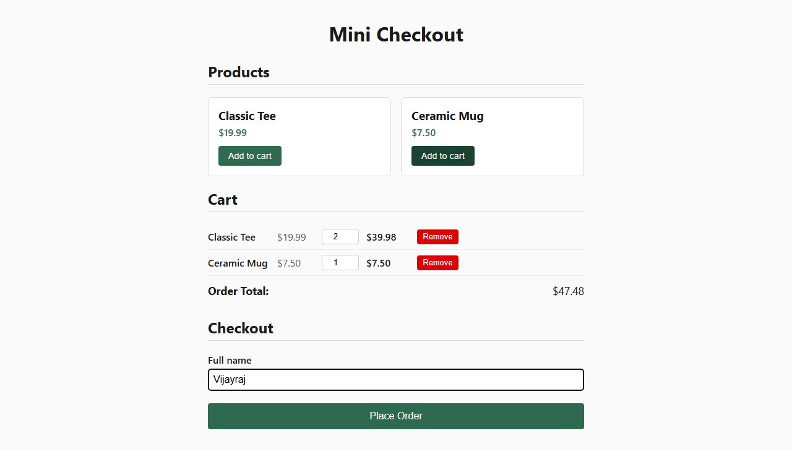

# Mini Checkout and Browser Test Suite

A minimal e-commerce checkout page built with vanilla HTML, CSS, and JavaScript, paired with a comprehensive Playwright test suite. Built for the FyndHacks SDET Intern selection round.



---

## Prerequisites

- **Node.js** 18 or newer
- **npm** (comes with Node.js)

## Setup

```bash
npm install
npx playwright install chromium
```

## Run the App

```bash
npm start
```

Then open [http://localhost:4173](http://localhost:4173) in your browser.

## Run the Tests

```bash
# Run all automated tests
npm test

# Headed mode (see the browser)
npx playwright test --headed

# View the HTML report
npm run report

# Repeat check (proves no flakiness)
npx playwright test --repeat-each=5
```

## What the Tests Cover

| ID    | Test Name                                          | What It Verifies                              |
|-------|----------------------------------------------------|-----------------------------------------------|
| AT-01 | Successful checkout produces a confirmation        | Happy path: add item → name → order → confirmation with ref, name, amount |
| AT-02 | Missing name blocks checkout                       | Blank name → error message, no confirmation, cart preserved |
| AT-03 | Quantity change updates the exact total             | 3×$19.99 + 2×$7.50 = $74.97 (integer-cents math) |
| AT-04 | Double click on Place Order gives one confirmation | dblclick and click({clickCount:3}) → exactly 1 confirmation |
| AT-05 | Empty cart blocks checkout                         | No items → cart error, name preserved, no confirmation |
| AT-06 | Validation preserves entered data                  | Add → name → remove → submit → name preserved, cart error |

## Documentation

- [Test Plan](docs/TEST_PLAN.md) — scope, risks, test cases, entry/exit criteria
- [Test Results](docs/TEST_RESULTS.md) — pass counts, repeat-run results, manual test records
- [Defect Log](docs/DEFECTS.md) — real defects only (or explicit "No defects found")
- [Evidence](evidence/) — screenshots, terminal output, HTML report

## Technical Decisions

| Area              | Decision                                                                 |
|-------------------|--------------------------------------------------------------------------|
| **App stack**     | Vanilla HTML, CSS, JavaScript. One page. No framework, no build step.    |
| **Test tool**     | Playwright Test (Node 18+), Chromium only.                               |
| **Server**        | `http-server` launched by Playwright `webServer` config.                 |
| **State**         | In-memory only. No localStorage, no cookies. Fresh state every test.     |
| **Money**         | Stored as integer cents. Formatted only when displaying. No float errors.|
| **Currency**      | `Intl.NumberFormat('en-US', { style: 'currency', currency: 'USD' })`     |
| **Data**          | Synthetic only. No credentials, no personal data.                        |

## Products

| ID  | Name        | Price              |
|-----|-------------|--------------------|
| tee | Classic Tee | $19.99 (1999 cents)|
| mug | Ceramic Mug | $7.50 (750 cents)  |

## Assumptions

- **Quantity rules:** Integer from 1 to 99. Blank, 0, negative, decimal, or non-numeric input reverts to the last valid quantity. Above 99 clamps to 99.
- State is in-memory, so a page refresh clears the cart.
- Single currency (USD), no tax, shipping, or discounts.
- Chromium only; no cross-browser or mobile testing.
- The order reference is random and client-generated, not unique across sessions.
- No formal accessibility audit; only a keyboard-flow check.
- No performance or load testing; no backend exists to test.

## Known Gaps / Not Tested

- Other browsers (Firefox, Safari, Edge)
- Mobile and responsive design testing
- Full accessibility audit (WCAG compliance)
- Performance and load testing
- Backend behaviour (no backend exists)
- Persistence across page reloads (by design: in-memory state)
- Payment integration, authentication, shipping calculations

## Video

_Video link (unlisted YouTube): TBD_
